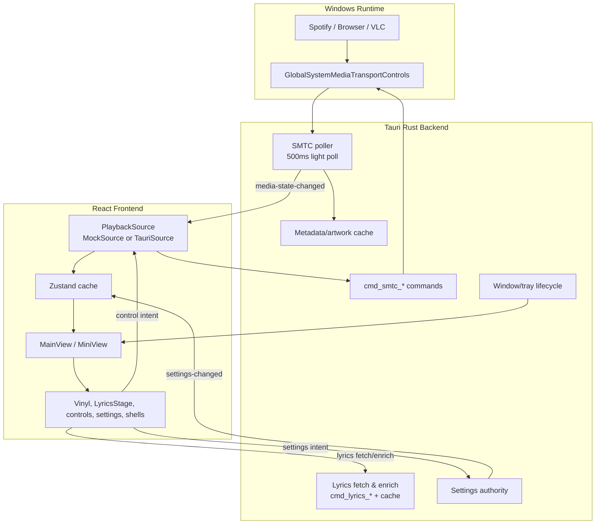
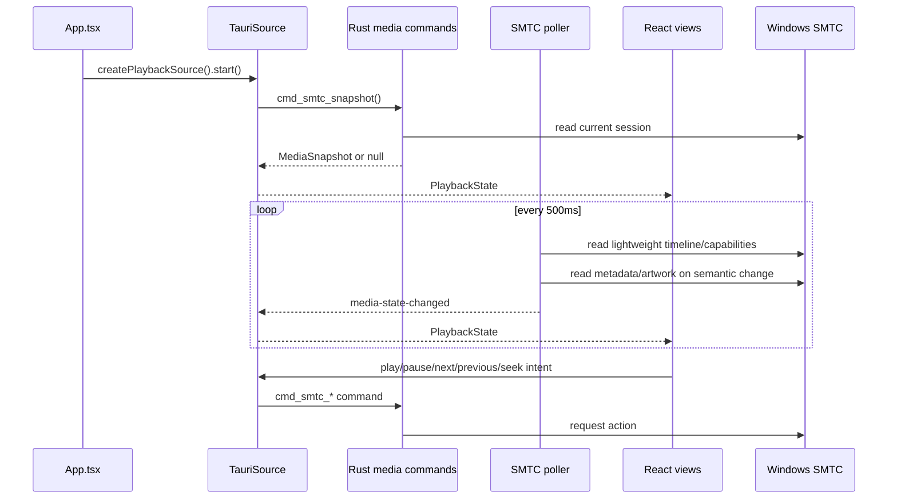
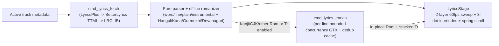
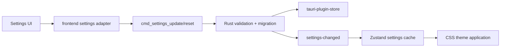
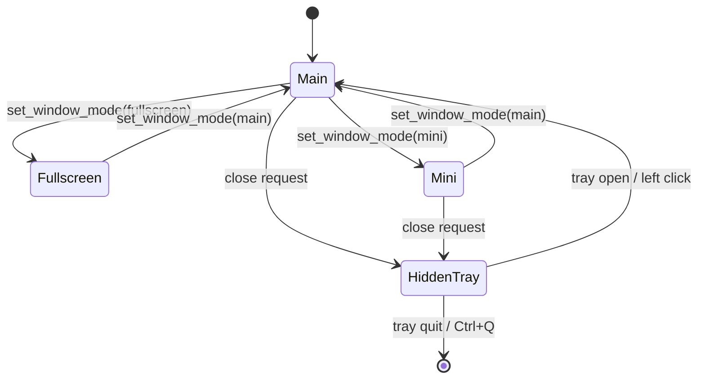

# VinylDeck Architecture

VinylDeck is split into a platform-neutral React visual engine and a Windows-specific Tauri backend. The central rule is simple: React renders; Rust owns native integration, CORS-free network resolution, durable settings, and real system media access.

## System Overview

## Playback Flow

The poller emits semantic changes immediately and position resyncs periodically. Artwork is cached by source, track, artist, album, and duration so it is not decoded every poll.

## Realtime Lyrics & Enrichment Pipeline

- **Zero-Flicker 60fps Sync Hot Path**: `useLyricsSync` updates React state only when `activeLineIndex` changes; active-word karaoke fill (`--word-progress` and `data-word-state`) and 3-dot interlude fills (`--dot-0`, `--dot-1`, `--dot-2`) mutate DOM refs directly inside `requestAnimationFrame`. Words render with a permanent dim `.lyrics-word__base` layer and an alpha-masked `.lyrics-word__fill` overlay, preventing WebView2 GPU layer blanking.
- **Offline + Per-Line Romanization & Translation**: `src/lib/lyrics/romanize.ts` provides instant, zero-dependency romanization for Korean Hangul, Japanese Kana, Punjabi Gurmukhi, and Hindi Devanagari plus proportional word alignment so enabling `Rom` replaces primary lyrics while keeping karaoke sweep intact. For Kanji/Chinese/Arabic/Cyrillic and translations, `cmd_lyrics_enrich` queries per unique line with bounded concurrency (`5` concurrent requests) to guarantee 1:1 line alignment without newline collapse.
- **Damped-Spring Scroll & Unified Axis**: Split View uses a continuous spring integrator targeting exact `getBoundingClientRect()` deltas with `50%` top/bottom spacers and a `ResizeObserver`. Collapsing the transport chrome dock on Lean-Back idle locks the vinyl platter and active lyric line onto one unified `50vh` horizontal center axis.
- **Auto-Hide**: Tracks resolving as `instrumental` or `not_found` collapse smoothly back to Pure Vinyl without altering `settings.lyricsEnabled`.

## State Ownership

| State                     | Authority                                      | Frontend role                                                            |
| ------------------------- | ---------------------------------------------- | ------------------------------------------------------------------------ |
| Playback in browser dev   | `MockSource`                                   | Visual development only                                                  |
| Playback in Tauri         | Windows SMTC through Rust                      | Render cache and command intent                                          |
| Persisted settings        | Rust settings authority                        | Optimistic UI plus backend-approved snapshots                            |
| Lyrics fetch & enrichment | Rust `lyrics` module (browser fallback in dev) | Pure parsing, offline romanization, 60fps rAF sync, damped-spring scroll |
| Runtime QA flags          | Zustand                                        | Local only                                                               |
| Window mode and lifecycle | Rust window/tray modules                       | Request mode changes                                                     |
| Theme application         | CSS custom properties                          | Apply backend-approved setting                                           |

## Current Visual Surface

The current app exposes two active shells: Noir and Glass. Older Aurora, Vapor, and Paper values remain migration inputs only. Album art still drives the vinyl pressing material and optional Art Ambient glow.

The active vinyl renderer is the CSS/DOM renderer. WebGL vinyl code remains in the repo as a dormant experiment with its feature flag hardcoded off. The center spindle hole is intentionally absent so album artwork remains unobscured.

## Settings Flow

Rust clamps and normalizes settings before persistence. Frontend validation is defensive only; WebViews are views/controllers, not durable storage authorities. Mini Transparency and Realtime Lyrics preferences (`lyricsEnabled`, `lyricsLayout`, `lyricsRomanized`, `lyricsAutoRomanize`, `lyricsTranslated`, `lyricsTargetLang`, `lyricsFontFamily`, `lyricsFontSize`, `lyricsSide`) share the same Rust-owned settings contract.

## Window And Lifecycle Model

Main and fullscreen reuse the `main` window. Mini is a separate frameless, transparent-capable, always-on-top WebView window. It starts at `280x280`, can shrink down to a small `140x140` floor, cannot expand beyond the original square, can opt into native Windows Acrylic blur-through through `miniTransparentMode`, and is destroyed when returning to main/fullscreen. Close requests hide to tray; explicit quit destroys windows and exits.

## Implementation Boundaries

- Real in-app playback uses SMTC through `cmd_smtc_*`.
- Browser mode remains mock-only by design.
- Shortcut editing UI and splash screen are not implemented.
- Public installer validation is tracked separately from architecture work.
- Tray playback menu code still uses the older backend media command path and should be unified with SMTC before distribution-grade release validation.

## v2.3.0 Architecture Updates

- **On-Disk Rust LRU Lyrics Cache**: `LyricsState` (`src-tauri/src/lyrics/mod.rs`) loads and atomically persists up to 250 track lyric payloads and 250 enrichment payloads in `app_data_dir()/lyrics_cache_v1.json` via `tokio::task::spawn_blocking` (`*.tmp` + rename). Negative misses stay memory-only so transient offline failures recover automatically after restart.
- **Unified System Tray & SMTC**: `src-tauri/src/tray.rs` invokes `media::commands::smtc_toggle_play_pause`, `smtc_next`, and `smtc_previous` directly and reads the latest live SMTC snapshot from `MediaState` (`std::sync::Mutex<MediaSnapshot>`), updated by `media::poller` and SMTC commands. Legacy `MockMediaAuthority` and `cmd_media_*` commands have been removed.
- **Zero-Shift Karaoke Rendering & Depth-of-Field Focus**: `LyricsStage` renders consistent word-span structure for both inactive and active lines (mounting `.lyrics-word__fill` only on the active line) while `finalizeWords()` preserves source reading order for overlapping background vocals. Distant Split View lines apply distance-scaled blur (`0.8px`–`1.8px`) that clears immediately on hover or manual scroll.
