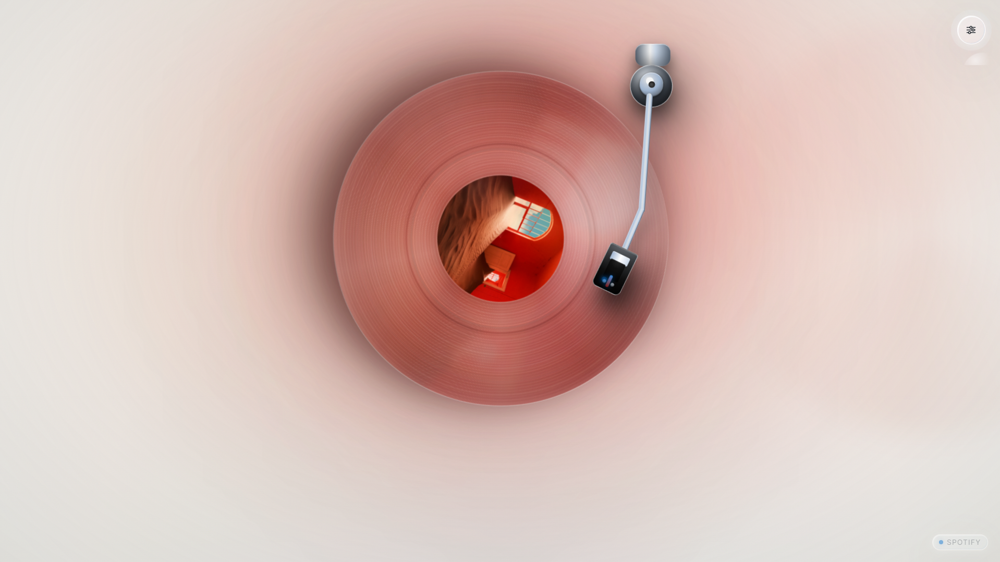
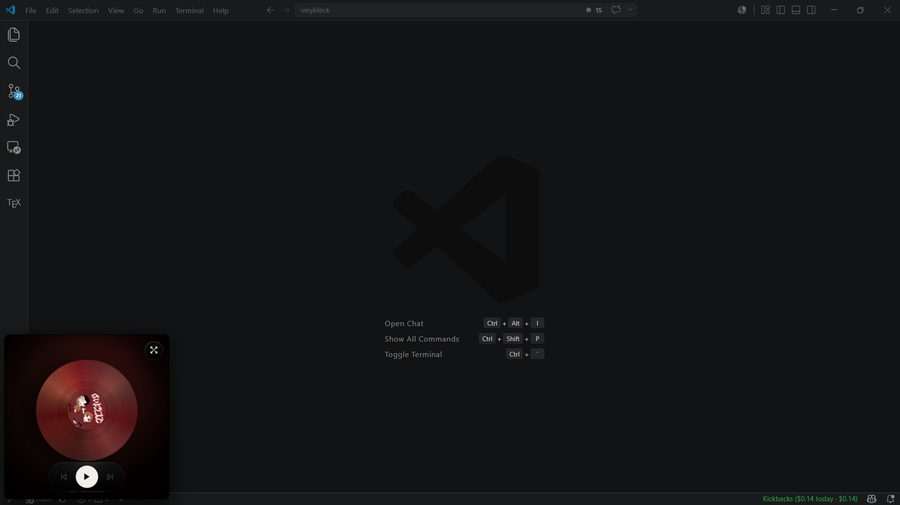
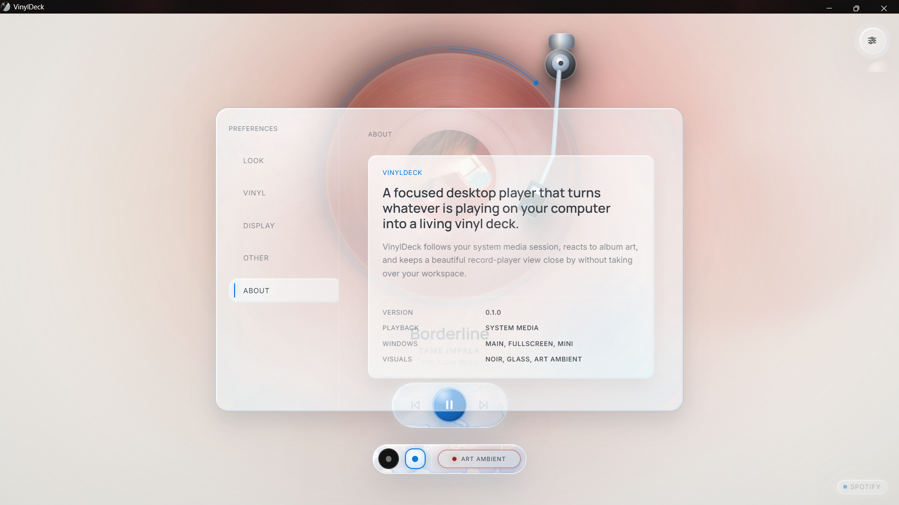

# User Guide

This guide covers using VinylDeck as a desktop companion for music already playing on Windows.

## Starting The App

Run VinylDeck in desktop mode:

```powershell
npm run tauri dev
```

Start playback in a Windows media app such as Spotify, a browser, or VLC. VinylDeck listens to the active system media session and renders the current track as a vinyl deck.

Browser development mode is available with mock playback:

```powershell
npm run dev
```

## Main Player

The main view combines:

- animated vinyl record with album art
- physical tonearm
- realtime synced lyrics (Split View or Compact Strip)
- track title, artist, and album
- progress ring and seek support when the source allows it
- play/pause, previous, and next controls
- shell picker
- source badge

Controls automatically disable when the active media source does not support that action. During Lean-Back idle, transport controls and corner chrome smoothly collapse and fade so the vinyl (and lyrics, when active) lock cleanly onto screen center.

## Realtime Lyrics

VinylDeck streams word-by-word karaoke lyrics and line-synced lyrics in Main and Fullscreen modes:

- **Split View** (`L` / `Shift+L`): Places the vinyl alongside a damped-spring scrolling lyrics column (configurable to **Lyrics Right** or **Lyrics Left** in **Settings -> Lyrics**), aligned to the turntable's optical center axis.
- **Compact Strip** (`Shift+L`): Keeps the vinyl centered with a calm 3-line focus window directly beneath the disc.
- **Instrumental gap dots (`• • •`)**: During intro silences (`>= 1.2s`) and inter-line musical breaks (`>= 3.0s`), three glowing dots fill sequentially to pace the instrumental gap smoothly before vocals return.
- **Background vocals**: Secondary and background vocal ad-libs tuck cleanly beneath their lead line in smaller, crisp typography.
- **Click-to-seek**: Click any timed lyric line to jump straight to that moment when the active media source supports seeking.
- **Manual scroll & Recenter**: Scrolling manually pauses auto-follow briefly and shows a Recenter button so you can read ahead and return smoothly.
- **Auto-hide on instrumentals**: When a track is instrumental or has no lyrics available, the lyrics panel glides away back to Pure Vinyl without turning off your lyrics setting—your next vocal track reopens lyrics automatically.
- **Romanized & Translated lyrics**: Toggle `Rom` (`R`) to **replace** non-Latin primary lyrics in-place with phonetic Latin script (instant offline support for Korean Hangul, Japanese Kana, Punjabi Gurmukhi, and Hindi Devanagari, plus per-line enrichment for Kanji, Chinese, Arabic, Cyrillic, and more—while preserving word-by-word karaoke sweep). Toggle `Tr` (`Shift+T`) to display translated subtitles stacked underneath in your chosen language (12 languages configurable in **Settings -> Lyrics**). Already-Latin tracks and tracks already in your target language automatically skip duplicates.

## Window Modes

| Mode | What it does |
| --- | --- |
| Main | Standard VinylDeck desktop window |
| Fullscreen | Immersive full-window player |
| Mini | Resizable always-on-top player |

<p align="center">
  
  
</p>

Mini starts as a `280x280` always-on-top player. You can shrink it down to a compact size, but it will not expand beyond the original square. As Mini gets smaller, the vinyl and hover controls scale down with the window and track text fades away to keep the record clear. Turn on Mini Transparency in Settings -> Display to let Windows Acrylic blur your desktop through the Mini player while the vinyl and controls stay readable.

Closing app windows can keep VinylDeck in the tray when Quit To Tray is enabled. Use tray Quit or `Ctrl+Q` for explicit exit.

## Keyboard Shortcuts

Shortcuts work while a VinylDeck window is focused.

| Action | Shortcut |
| --- | --- |
| Play / pause | `Space` |
| Previous | `Left` |
| Next | `Right` |
| Show / hide lyrics | `L` |
| Switch lyrics layout (Split / Strip) | `Shift+L` |
| Toggle romanized lyrics | `R` |
| Toggle translated lyrics | `Shift+T` |
| Fullscreen | `F` |
| Mini player | `M` |
| Cycle shell | `T` |
| Settings | `S` |
| Toggle Art Ambient | `A` |
| Close settings / leave fullscreen | `Escape` |
| Quit | `Ctrl+Q` |

Disable shortcuts in Settings -> Other. Escape remains available for closing Settings and leaving fullscreen.

Start With Windows is opt-in. When enabled, VinylDeck launches automatically after sign-in so it can sit ready while you start music normally.

## Settings

Settings persist across app windows.

<p align="center">
  
</p>

| Section | Options |
| --- | --- |
| Look | Noir and Glass visual shells, Art Ambient |
| Vinyl | Vinyl wobble, film grain |
| Lyrics | Show Lyrics, Stage Layout (Split View / Compact Strip), Lyrics Side (Right / Left), Font Style (Display / Clean Sans / Editorial / Studio Mono), Text Size (Small–Extra Large), Auto-Romanize Foreign Scripts, Romanized Lyrics, Translated Lyrics (manual only), Translation Language |
| Display | Window mode (Main/Fullscreen/Mini), Always On Top, Lean-Back Mode, Cursor Hide, Idle Timeout, Mini Transparency |
| Other | Keyboard Shortcuts, Quit To Tray, Start With Windows |
| About | App identity and build information |

## Context Menu

Right-click the player to open the slim VinylDeck command menu. It keeps only essential actions: playback (`Play/Pause`, `Previous`, `Next`), `Show/Hide Lyrics`, `Art Ambient`, `Fullscreen`, `Mini Player`, `Settings`, and `Quit`. Detailed lyrics toggles live on the lyrics utility strip, keyboard shortcuts, and **Settings -> Lyrics**. Mini mode keeps only actions that make sense for the compact window.

## Visual Behavior

- Noir and Glass are the current visual shells.
- Art Ambient uses album colors to tint the atmosphere.
- Track changes triggered inside VinylDeck animate directionally.
- The record stays visually anchored and receives an in-place skip impulse, with continuous spin across Pure Vinyl, Split View, and Compact Strip transitions.

## Troubleshooting

See [Troubleshooting](./TROUBLESHOOTING.md) for media-session detection, realtime lyrics, disabled controls, WebView2, tray, and shortcut issues.


### v2.3.0 Refinements
- **Depth-of-Field Lyric Focus**: Distant lines in Split View gently soften so the active line stands out; hover the lyrics column or scroll manually to sharpen all lines immediately.
- **Instant 0ms Lyrics Reload**: Lyrics and language enrichments are cached locally on disk (up to 250 tracks) so previously played songs appear instantaneously across app restarts.
- **Unified System Tray Controls**: Right-clicking the tray icon now drives your active Windows SMTC media session directly and displays live track/artist status in the tray tooltip.
