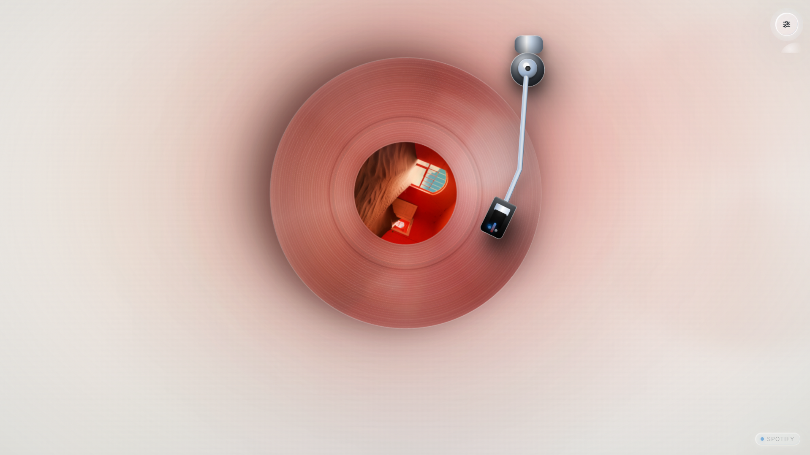
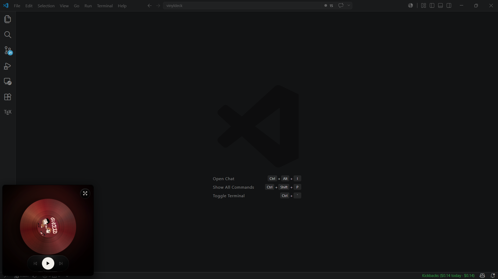
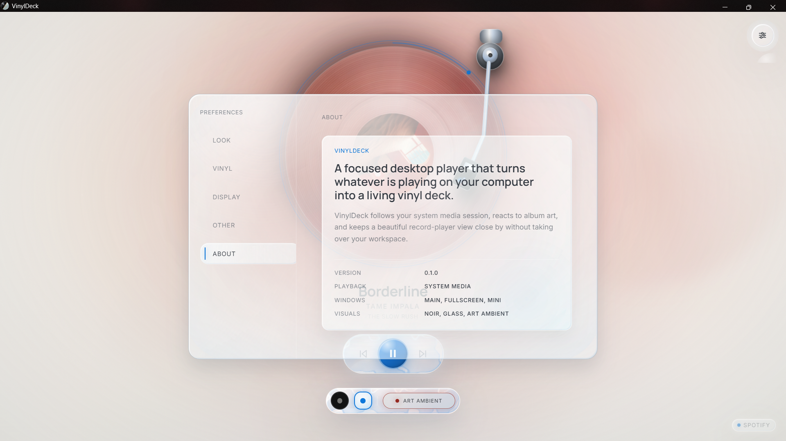

# User Guide

This guide covers using VinylDeck as a desktop companion for music already playing on Windows.

## Starting The App

Run VinylDeck in desktop mode:

```powershell
npm run tauri dev
```

Start playback in a Windows media app such as Spotify, a browser, or VLC. VinylDeck listens to the active system media session and renders the current track as a vinyl deck.

Browser development mode is available with mock playback:

```powershell
npm run dev
```

## Main Player

The main view combines:

- animated vinyl record with album art
- physical tonearm
- track title, artist, and album
- progress ring and seek support when the source allows it
- play/pause, previous, and next controls
- shell picker
- source badge

Controls automatically disable when the active media source does not support that action.

## Discogs Artwork

When a token is configured, VinylDeck looks up the playing album on Discogs and presses its image onto the record label. Tracks from the same album share one lookup.

1. Create a personal access token in [Discogs developer settings](https://www.discogs.com/settings/developers).
2. Run `setx DISCOGS_TOKEN "your-token"` in a terminal.
3. Quit VinylDeck from the tray and open it again. If it still reports no token, sign out of Windows and back in.

If Discogs has an image for the album, a record button appears under Settings in the main window. It lists the covers of the album's different versions, then other photos such as the back cover and the disc label. Click a thumbnail to change the image without interrupting playback.

Use **Center** or **Whole disc** to choose where the image goes. By default, a photo of the record itself fills the whole disc and any other image goes on the center. Use **Adjust image** to drag the image into position and set its zoom. **Fit** shows the whole image inside the circle, and **Reset** undoes the adjustment. Changing between Center and Whole disc also resets it.

Use **All editions of this album** to see every edition listed on Discogs, such as each vinyl pressing, CD, and cassette, with a filter by format. Open one to see its own images, including photos of that record, and click any of them to use it. An edition's name, such as "Glow In The Dark", appears shortly after its row comes into view. If it takes longer, VinylDeck is waiting to stay within the Discogs request limit.

VinylDeck remembers these choices for each image of the album, including in the Mini player. They apply to Discogs images, so artwork that comes only from the player can't be adjusted.

The record falls back to your player's artwork when:

- no token is set
- the player does not report both an artist and an album
- Discogs has no confident match or no images
- Discogs is unreachable and nothing is saved for that album

Artwork you have already seen on the record stays available offline.

## Vinyl Crackle

Turn on **Settings > Vinyl > Vinyl Crackle** to hear soft hiss and occasional pops while a track plays, and set the level with **Crackle Volume**. It is off by default.

The noise plays over your music and does not change the music itself. It has its own level, so your player's volume does not affect it. It keeps playing in Mini and when VinylDeck is in the tray, and stops when playback pauses or you quit.

## Window Modes

| Mode | What it does |
| --- | --- |
| Main | Standard VinylDeck desktop window |
| Fullscreen | Immersive full-window player |
| Mini | Resizable always-on-top player |

<p align="center">
  
  
</p>

Mini starts as a `280x280` always-on-top player. You can shrink it down to a compact size, but it will not expand beyond the original square. As Mini gets smaller, the vinyl and hover controls scale down with the window and track text fades away to keep the record clear. Turn on Mini Transparency in Settings -> Display to let Windows Acrylic blur your desktop through the Mini player while the vinyl and controls stay readable.

Closing app windows can keep VinylDeck in the tray when Quit To Tray is enabled. Use tray Quit or `Ctrl+Q` for explicit exit.

## Keyboard Shortcuts

Shortcuts work while a VinylDeck window is focused.

| Action | Shortcut |
| --- | --- |
| Play / pause | `Space` |
| Previous | `Left` |
| Next | `Right` |
| Fullscreen | `F` |
| Mini player | `M` |
| Cycle shell | `T` |
| Settings | `S` |
| Toggle Art Ambient | `A` |
| Close settings / leave fullscreen | `Escape` |
| Quit | `Ctrl+Q` |

Disable shortcuts in Settings -> Other. Escape remains available for closing Settings and leaving fullscreen.

Start With Windows is opt-in. When enabled, VinylDeck launches automatically after sign-in so it can sit ready while you start music normally.

## Settings

Settings persist across app windows.

<p align="center">
  
</p>

| Section | Options |
| --- | --- |
| Look | Noir and Glass visual shells |
| Vinyl | Vinyl wobble, film grain, album-art ambient lighting |
| Display | Main/fullscreen/mini, always-on-top, lean-back, cursor behavior, idle timeout, Mini Transparency |
| Other | Keyboard Shortcuts, Quit To Tray, Start With Windows |
| About | App identity and build information |

## Context Menu

Right-click the player to open the VinylDeck command menu. It includes playback actions, Art Ambient, fullscreen, mini player, Settings, and Quit. Mini mode keeps only actions that make sense for the compact window.

## Visual Behavior

- Noir and Glass are the current visual shells.
- Art Ambient uses album colors to tint the atmosphere.
- Track changes triggered inside VinylDeck animate directionally.
- The record stays visually anchored and receives an in-place skip impulse.

## Troubleshooting

See [Troubleshooting](./TROUBLESHOOTING.md) for media-session detection, disabled controls, WebView2, tray, and shortcut issues.
